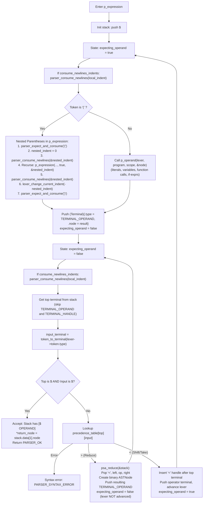

# Precedence Syntax Analysis (PSA) Specification & Implementation Plan

This document specifies the complete architecture and implementation plan for the bottom-up operator precedence parser across [psa.h](file:///home/edword/ifj26-compiler/src/psa.h), [psa.c](file:///home/edword/ifj26-compiler/src/psa.c), and [parser.c](file:///home/edword/ifj26-compiler/src/parser.c).

Under this design, **nested parentheses are handled directly within [`p_expression`](file:///home/edword/ifj26-compiler/src/parser.c#L621)** whenever an opening parenthesis `(` is encountered during operand intake. [`p_operand`](file:///home/edword/ifj26-compiler/src/parser.c#L514) is kept strictly atomic (handling literals, variable references, function calls, and if-expressions), completely freeing it from indentation tracking and layout tokens.

---

### High-Level Architecture Overview & Rationale

#### 1. Why Nested Parentheses Belong in `p_expression`, Not `p_operand`
* **Clean Abstraction in [`p_operand`](file:///home/edword/ifj26-compiler/src/parser.c#L514)**:
  `p_operand` is responsible exclusively for leaf/primary operands: literals (`Int`, `Double`, `String`), variable references, function calls, and `if` expressions.
  Function calls already manage their own argument list parentheses internally (`p_call_args`).
  Therefore, by removing parenthesized expressions from `p_operand`, `p_operand` never needs `local_indent` or `consume_newlines_indents` passed to it, and never encounters multiline layout tokens (`TOKEN_NEWLINE`, `TOKEN_INDENT`, `TOKEN_DEDENT`).
* **Indentation Belongs to the Parenthesis Scope in [`p_expression`](file:///home/edword/ifj26-compiler/src/parser.c#L621)**:
  `p_expression` already takes `bool consume_newlines_indents` and `ptrdiff_t *local_indent`.
  According to the language layout rules, lines inside parentheses must be indented deeper than the line with the opening parenthesis, and **nested parentheses must track their indentation separately**:
  ```scala
  if ( (bool) &&
          ( bool
            ) // valid code: indent in nested parentheses is tracked independently
    ) then statement;
  ```
  When `(` is encountered in `p_expression`, it spins up a fresh `ptrdiff_t nested_indent = 0`, parses the sub-expression recursively via `p_expression(..., true, &nested_indent)`, resets indentation via `lexer_change_current_indent(lexer, (-1) * nested_indent)`, and consumes `)`.
* **Zero Parenthesis Overhead in Precedence Table**:
  Neither `(` nor `)` exist in the operator precedence table.
  To the inner `p_expression`, `)` acts as `TERMINAL_DOLLAR` (an expression boundary).
  To the outer `p_expression`, the entire parenthesized expression `( ... )` enters the precedence stack directly as an evaluated `TERMINAL_OPERAND`.

#### 2. The State Alternation Model (`expecting_operand`)
Expressions strictly alternate between operands and operators:
1. `expecting_operand == true`:
   The next token must be an operand. If it is `(`, `p_expression` handles the nested sub-expression directly. Otherwise, `p_operand` parses the atomic token. The resulting AST node is pushed onto the stack as `TERMINAL_OPERAND`, and the state switches to `expecting_operand = false`.
   Any unexpected token (such as a bare operator or delimiter) produces an immediate syntax error.
2. `expecting_operand == false`:
   The next token must be an operator or delimiter. We inspect the top terminal on the stack (skipping `TERMINAL_OPERAND` and `TERMINAL_HANDLE`) and compare it against the input terminal in the precedence table:
   * **Accept**: Top is `$` and Input is `$`. The expression is complete.
   * **Shift (`<`)**: Insert `<` handle after the top terminal, push the operator terminal, advance the lexer, and transition back to `expecting_operand = true`.
   * **Reduce (`>`)**: Invoke `psa_reduce`, which pops `< left op right`, constructs a binary `ASTNode`, pushes the resulting `TERMINAL_OPERAND`, and stays in `expecting_operand = false` (lexer is not advanced).



---

### 1. Stack Item Representation ([`src/psa.h`](file:///home/edword/ifj26-compiler/src/psa.h))

Because `(` and `)` are factored out of the precedence table entirely, the precedence table requires only **7 terminals** (the operators and the delimiter `$`).

To keep the precedence table compact, operators with identical precedence and associativity (e.g. all 6 relational operators `<`, `<=`, `>`, `>=`, `==`, `!=`) are grouped under a single `TerminalType` (`TERMINAL_REL`). To preserve the exact operation and source coordinates for AST construction without enlarging the precedence table, `Terminal` stores the original `Token`:

```c
typedef enum {
  // Terminals participating in the precedence table (indices 0 to 6)
  TERMINAL_PLUS,    // +
  TERMINAL_MINUS,   // -
  TERMINAL_MUL,     // *
  TERMINAL_DIV,     // /
  TERMINAL_CONCAT,  // ++
  TERMINAL_REL,     // <, <=, >, >=, ==, !=
  TERMINAL_DOLLAR,  // $ stack bottom / end of expression delimiter (\n, ;, ,, ), etc.)
  TERMINAL_COUNT,   // = 7 (dimension of precedence table)

  // Stack symbols (never looked up in precedence table)
  TERMINAL_OPERAND, // Evaluated AST node (literal, variable, call, parenthesized expr)
  TERMINAL_HANDLE,  // '<' reduction handle marker
  TERMINAL_INVALID  // Sentinel for syntax errors
} TerminalType;

typedef struct {
  TerminalType type;
  Token token;      // Full original token for operators/delimiters; TOKEN_INVALID for TERMINAL_OPERAND
  ASTNode *node;    // Non-null for TERMINAL_OPERAND, NULL for operators/delimiters
} Terminal;

typedef struct {
  Terminal *data;
  size_t size;
  size_t capacity;
} TerminalStack;
```

---

### 2. Token Mapping in `token_to_terminal` ([`src/psa.c`](file:///home/edword/ifj26-compiler/src/psa.c))

When the parser is in `expecting_operand == false`, incoming tokens are mapped to their operator terminal or `TERMINAL_DOLLAR`. Operands and `TOKEN_LEFT_PAREN` map to `TERMINAL_INVALID` in this state, preventing consecutive operand errors (e.g. `1 2` or `x ( y )`).

```c
static TerminalType token_to_terminal(TokenType token) {
  switch (token) {
  case TOKEN_PLUS:
    return TERMINAL_PLUS;
  case TOKEN_MINUS:
    return TERMINAL_MINUS;
  case TOKEN_MULTIPLY:
    return TERMINAL_MUL;
  case TOKEN_DIVIDE:
    return TERMINAL_DIV;
  case TOKEN_LIST_CONCAT:
    return TERMINAL_CONCAT;

  // Relational operators all share the same precedence level
  case TOKEN_EQUAL:
  case TOKEN_NOT_EQUAL:
  case TOKEN_LESS:
  case TOKEN_GREATER:
  case TOKEN_LESS_EQUAL:
  case TOKEN_GREATER_EQUAL:
    return TERMINAL_REL;

  // Delimiters marking the end of an expression -> act as '$'
  case TOKEN_EOF:
  case TOKEN_NEWLINE:
  case TOKEN_SEMICOLON:
  case TOKEN_COMMA:
  case TOKEN_COLON:
  case TOKEN_RIGHT_BRACKET:
  case TOKEN_RIGHT_PAREN:  // Ends inner parenthesized expression or call argument!
  case TOKEN_DEDENT:
  case TOKEN_KW_THEN:
  case TOKEN_KW_DO:
  case TOKEN_KW_ELSE:
    return TERMINAL_DOLLAR;

  default:
    return TERMINAL_INVALID;
  }
}
```

---

### 3. Separation of Concerns: Clean `p_operand` vs Nested Parentheses in `p_expression`

#### Clean `p_operand` ([`src/parser.c`](file:///home/edword/ifj26-compiler/src/parser.c#L514))
[`p_operand`](file:///home/edword/ifj26-compiler/src/parser.c#L514) does not accept `local_indent` or `consume_newlines_indents`. It only parses atomic operands:

```c
static ParserStatus p_operand(Lexer *lexer, Program *program,
                              SymbolTable *scope, ASTNode **return_node) {
  if (lexer == NULL || program == NULL || scope == NULL || return_node == NULL) {
    return PARSER_INVALID_ARGUMENT;
  }

  switch (lexer->token.type) {
  case TOKEN_INT:
    *return_node = ast_node_create_int(lexer->token.value.int_value,
                                       lexer->token.line, lexer->token.column);
    return (*return_node != NULL) ? parser_advance(lexer) : PARSER_INTERNAL_ERROR;

  case TOKEN_DOUBLE:
    *return_node = ast_node_create_real(lexer->token.value.double_value,
                                        lexer->token.line, lexer->token.column);
    return (*return_node != NULL) ? parser_advance(lexer) : PARSER_INTERNAL_ERROR;

  case TOKEN_STRING:
    *return_node = ast_node_create_string(lexer->token.value.string_value,
                                          lexer->token.line, lexer->token.column);
    return (*return_node != NULL) ? parser_advance(lexer) : PARSER_INTERNAL_ERROR;

  case TOKEN_IDENTIFIER: {
    char *name = lexer->token.value.string_value;
    size_t line = lexer->token.line;
    size_t column = lexer->token.column;

    ParserStatus status = parser_advance(lexer);
    if (status != PARSER_OK) {
      return status;
    }

    if (lexer->token.type == TOKEN_LEFT_PAREN) {
      // Function call (p_call_args internally manages its own argument parentheses)
      FunctionSymbol *function = NULL;
      if (function_table_get_or_create(&program->functions, name, &function) != FUNCTION_TABLE_OK) {
        return PARSER_INTERNAL_ERROR;
      }
      ASTNode *call_node = ast_node_create_function_call(function, line, column);
      if (call_node == NULL) {
        return PARSER_INTERNAL_ERROR;
      }
      status = p_call_args(lexer, program, function, scope, call_node);
      if (status != PARSER_OK) {
        ast_node_destroy(call_node);
        return status;
      }
      status = parser_status_from_type(type_entity_depend(&function->return_type, &call_node->inferred_type));
      if (status != PARSER_OK) {
        ast_node_destroy(call_node);
        return status;
      }
      *return_node = call_node;
      return PARSER_OK;
    } else {
      // Variable reference
      Symbol *symbol = symbol_table_resolve(scope, name);
      if (symbol == NULL) {
        return PARSER_SEMANTIC_ERROR;
      }
      ASTNode *var_node = ast_node_create_variable_ref(symbol, line, column);
      if (var_node == NULL) {
        return PARSER_INTERNAL_ERROR;
      }
      status = parser_status_from_type(type_entity_depend(&symbol->type, &var_node->inferred_type));
      if (status != PARSER_OK) {
        ast_node_destroy(var_node);
        return status;
      }
      *return_node = var_node;
      return PARSER_OK;
    }
  }

  case TOKEN_KW_IF:
    return p_if_expression(lexer, program, scope, return_node);

  default:
    return PARSER_SYNTAX_ERROR;
  }
}
```

#### Nested Parentheses in `p_expression` ([`src/parser.c`](file:///home/edword/ifj26-compiler/src/parser.c#L621))
When `lexer->token.type == TOKEN_LEFT_PAREN` in `expecting_operand`:
```c
// 1. Consume '('
status = parser_expect_and_consume(lexer, TOKEN_LEFT_PAREN);
if (status != PARSER_OK) {
  terminal_stack_destroy(&stack);
  return status;
}

// 2. Parentheses manage their own separate indentation tracking
ptrdiff_t nested_indent = 0;
status = parser_consume_newlines(lexer, false, true, &nested_indent);
if (status != PARSER_OK) {
  terminal_stack_destroy(&stack);
  return status;
}

// 3. Recursively parse inner expression
ASTNode *inner_node = NULL;
status = p_expression(lexer, program, scope, &inner_node, true, &nested_indent);
if (status != PARSER_OK) {
  terminal_stack_destroy(&stack);
  return status;
}
if (inner_node == NULL) {
  // Empty parentheses `()` are invalid syntax
  terminal_stack_destroy(&stack);
  return PARSER_SYNTAX_ERROR;
}

// 4. Consume any trailing newlines/indents before ')'
status = parser_consume_newlines(lexer, false, true, &nested_indent);
if (status != PARSER_OK) {
  ast_node_destroy(inner_node);
  terminal_stack_destroy(&stack);
  return status;
}

// 5. Reset indentation delta to the level before '('
status = parser_status_from_lexer(
    lexer_change_current_indent(lexer, (-1) * nested_indent));
if (status != PARSER_OK) {
  ast_node_destroy(inner_node);
  terminal_stack_destroy(&stack);
  return status;
}

// 6. Consume matching ')'
status = parser_expect_and_consume(lexer, TOKEN_RIGHT_PAREN);
if (status != PARSER_OK) {
  ast_node_destroy(inner_node);
  terminal_stack_destroy(&stack);
  return status;
}

// 7. Push evaluated inner node as TERMINAL_OPERAND onto stack
Terminal op_term = {.type = TERMINAL_OPERAND, .token = (Token){.type = TOKEN_INVALID}, .node = inner_node};
status = terminal_stack_push(&stack, op_term);
if (status != PARSER_OK) {
  ast_node_destroy(inner_node);
  terminal_stack_destroy(&stack);
  return status;
}
```

---

### 4. Compact 7x7 Precedence Table ([`src/psa.c`](file:///home/edword/ifj26-compiler/src/psa.c))

Operator precedence hierarchy (from highest to lowest):
1. Multiplicative: `*`, `/` (Left-associative)
2. Additive: `+`, `-` (Left-associative)
3. Concatenation: `++` (Right-associative: `a ++ b ++ c` $\to$ `a ++ (b ++ c)`)
4. Relational: `<`, `<=`, `>`, `>=`, `==`, `!=` (Non-associative: `a < b < c` is a syntax error)
5. Delimiter: `$` (Stack bottom / end of expression)

The resulting table is **7 $\times$ 7**:

```c
#define T PREC_TAKE    // '<' (shift operator)
#define R PREC_REDUCE  // '>' (reduce handle)
#define I PREC_INVALID // ' ' (syntax error / acceptance)

static const PRECEDENCE precedence_table[TERMINAL_COUNT][TERMINAL_COUNT] = {
/* Stack \ Input:  +   -   *   /  ++  rel  $  */
/* +       */   {  R,  R,  T,  T,  R,  R,  R  },
/* -       */   {  R,  R,  T,  T,  R,  R,  R  },
/* *       */   {  R,  R,  R,  R,  R,  R,  R  },
/* /       */   {  R,  R,  R,  R,  R,  R,  R  },
/* ++      */   {  T,  T,  T,  T,  T,  R,  R  },
/* rel     */   {  T,  T,  T,  T,  T,  I,  R  },
/* $       */   {  T,  T,  T,  T,  T,  T,  I  },
};
#undef T
#undef R
#undef I
```

---

### 5. Streamlined Reduction Engine (`psa_reduce`)

Because operands are directly pushed onto the stack as `TERMINAL_OPERAND` and `<` handles are only inserted when shifting operators, `psa_reduce` only ever needs to handle **one single reduction rule**: `< OPERAND op OPERAND`.

By inspecting `op.token.type`, `create_binary_node` distinguishes the exact operation (distinguishing all relational operators, concatenation, etc.) and retrieves exact source coordinates (`op.token.line`, `op.token.column`) without enlarging the precedence table with separate rows/columns for each operator.

```c
static ASTNode *create_binary_node(Terminal op, ASTNode *left, ASTNode *right) {
  ASTNodeKind kind;
  switch (op.token.type) {
  case TOKEN_PLUS:          kind = AST_ADD; break;
  case TOKEN_MINUS:         kind = AST_SUBTRACT; break;
  case TOKEN_MULTIPLY:      kind = AST_MULTIPLY; break;
  case TOKEN_DIVIDE:        kind = AST_DIVIDE; break;
  case TOKEN_LIST_CONCAT:   kind = AST_CONCAT; break;
  case TOKEN_EQUAL:         kind = AST_EQUAL; break;
  case TOKEN_NOT_EQUAL:     kind = AST_NOT_EQUAL; break;
  case TOKEN_LESS:          kind = AST_LESS; break;
  case TOKEN_LESS_EQUAL:    kind = AST_LESS_EQUAL; break;
  case TOKEN_GREATER:       kind = AST_GREATER; break;
  case TOKEN_GREATER_EQUAL: kind = AST_GREATER_EQUAL; break;
  case TOKEN_AND:           kind = AST_AND; break;
  case TOKEN_OR:            kind = AST_OR; break;
  default:
    return NULL;
  }
  return ast_node_create_binary_op(kind, left, right, op.token.line, op.token.column);
}

static ParserStatus psa_reduce(TerminalStack *stack) {
  // Reduction pattern must be exactly 4 items: '<' OPERAND op OPERAND
  if (stack->size < 4U) {
    return PARSER_SYNTAX_ERROR;
  }

  size_t top_idx = stack->size - 1U;
  Terminal right  = stack->data[top_idx];
  Terminal op     = stack->data[top_idx - 1U];
  Terminal left   = stack->data[top_idx - 2U];
  Terminal handle = stack->data[top_idx - 3U];

  if (handle.type != TERMINAL_HANDLE ||
      left.type != TERMINAL_OPERAND ||
      right.type != TERMINAL_OPERAND) {
    return PARSER_SYNTAX_ERROR;
  }

  ASTNode *bin_node = create_binary_node(op, left.node, right.node);
  if (bin_node == NULL) {
    return PARSER_INTERNAL_ERROR;
  }

  // Pop '<', left, op, right (4 items)
  stack->size -= 4U;

  // Push resulting evaluated operand
  Terminal result = {
    .type = TERMINAL_OPERAND,
    .token = (Token){.type = TOKEN_INVALID, .line = op.token.line, .column = op.token.column},
    .node = bin_node
  };
  return terminal_stack_push(stack, result);
}
```

---

### 6. Acceptance & Termination

1. Expression delimiters (`\n`, `;`, `,`, `)`, `then`, `do`, `EOF`) map to `TERMINAL_DOLLAR`.
2. PSA does not consume delimiter tokens: they remain in `lexer->token` for the caller (or parent `p_expression`) to inspect or consume.
3. Operators on the stack continue reducing until the stack contains `[$ , OPERAND]`.
4. When `top_terminal == TERMINAL_DOLLAR` and `input_terminal == TERMINAL_DOLLAR`:
   * **Accept**: set `*return_node = stack->data[1].node`.
   * Free the stack structure and return `PARSER_OK`.
5. If outer, the statement parser proceeds. If inside a nested parenthesized expression, control returns to the outer `p_expression`, which consumes `)`.

---

### 7. Complete `p_expression` Main Loop Specification ([`src/parser.c`](file:///home/edword/ifj26-compiler/src/parser.c#L621))

Below is the complete implementation of [`p_expression`](file:///home/edword/ifj26-compiler/src/parser.c#L621):

```c
// Helper to safely clean up all AST nodes remaining on stack on syntax/internal errors
static void terminal_stack_cleanup_nodes(TerminalStack *stack) {
  if (stack == NULL || stack->data == NULL) return;
  for (size_t i = 0; i < stack->size; i++) {
    if (stack->data[i].type == TERMINAL_OPERAND && stack->data[i].node != NULL) {
      ast_node_destroy(stack->data[i].node);
      stack->data[i].node = NULL;
    }
  }
  terminal_stack_destroy(stack);
}

static ParserStatus p_expression(Lexer *lexer, Program *program,
                                 SymbolTable *scope, ASTNode **return_node,
                                 bool consume_newlines_indents,
                                 ptrdiff_t *local_indent) {
  if (lexer == NULL || program == NULL || scope == NULL || return_node == NULL) {
    return PARSER_INVALID_ARGUMENT;
  }
  if (consume_newlines_indents && local_indent == NULL) {
    return PARSER_INVALID_ARGUMENT;
  }

  TerminalStack stack;
  ParserStatus status = terminal_stack_init(&stack);
  if (status != PARSER_OK) {
    return status;
  }

  // Push '$' as stack bottom
  Terminal bottom = {.type = TERMINAL_DOLLAR, .token = (Token){.type = TOKEN_INVALID}, .node = NULL};
  status = terminal_stack_push(&stack, bottom);
  if (status != PARSER_OK) {
    terminal_stack_destroy(&stack);
    return status;
  }

  bool expecting_operand = true;

  while (true) {
    if (expecting_operand) {
      // 1. Consume any leading newlines/indents if multiline is permitted
      if (consume_newlines_indents) {
        status = parser_consume_newlines(lexer, false, true, local_indent);
        if (status != PARSER_OK) {
          terminal_stack_cleanup_nodes(&stack);
          return status;
        }
      }

      // 2. Dispatch operand: nested '(' expr ')' OR atomic operand via p_operand
      if (lexer->token.type == TOKEN_LEFT_PAREN) {
        // --- Nested Parenthesized Expression ---
        status = parser_expect_and_consume(lexer, TOKEN_LEFT_PAREN);
        if (status != PARSER_OK) {
          terminal_stack_cleanup_nodes(&stack);
          return status;
        }

        // Parentheses manage their own separate indentation tracking
        ptrdiff_t nested_indent = 0;
        status = parser_consume_newlines(lexer, false, true, &nested_indent);
        if (status != PARSER_OK) {
          terminal_stack_cleanup_nodes(&stack);
          return status;
        }

        ASTNode *inner_node = NULL;
        status = p_expression(lexer, program, scope, &inner_node, true, &nested_indent);
        if (status != PARSER_OK) {
          terminal_stack_cleanup_nodes(&stack);
          return status;
        }
        if (inner_node == NULL) {
          terminal_stack_cleanup_nodes(&stack);
          return PARSER_SYNTAX_ERROR;
        }

        status = parser_consume_newlines(lexer, false, true, &nested_indent);
        if (status != PARSER_OK) {
          ast_node_destroy(inner_node);
          terminal_stack_cleanup_nodes(&stack);
          return status;
        }

        status = parser_status_from_lexer(
            lexer_change_current_indent(lexer, (-1) * nested_indent));
        if (status != PARSER_OK) {
          ast_node_destroy(inner_node);
          terminal_stack_cleanup_nodes(&stack);
          return status;
        }

        status = parser_expect_and_consume(lexer, TOKEN_RIGHT_PAREN);
        if (status != PARSER_OK) {
          ast_node_destroy(inner_node);
          terminal_stack_cleanup_nodes(&stack);
          return status;
        }

        Terminal op_term = {.type = TERMINAL_OPERAND, .token = (Token){.type = TOKEN_INVALID}, .node = inner_node};
        status = terminal_stack_push(&stack, op_term);
        if (status != PARSER_OK) {
          ast_node_destroy(inner_node);
          terminal_stack_cleanup_nodes(&stack);
          return status;
        }
      } else {
        // --- Atomic Operand ---
        ASTNode *operand_node = NULL;
        status = p_operand(lexer, program, scope, &operand_node);
        if (status != PARSER_OK) {
          terminal_stack_cleanup_nodes(&stack);
          return status;
        }

        Terminal op_term = {.type = TERMINAL_OPERAND, .token = (Token){.type = TOKEN_INVALID}, .node = operand_node};
        status = terminal_stack_push(&stack, op_term);
        if (status != PARSER_OK) {
          ast_node_destroy(operand_node);
          terminal_stack_cleanup_nodes(&stack);
          return status;
        }
      }

      // Next token must be an operator or delimiter
      expecting_operand = false;

    } else {
      // --- Expecting Operator or End-of-Expression Delimiter ---
      if (consume_newlines_indents) {
        status = parser_consume_newlines(lexer, false, true, local_indent);
        if (status != PARSER_OK) {
          terminal_stack_cleanup_nodes(&stack);
          return status;
        }
      }

      Terminal top_terminal;
      status = stack_get_top_terminal(&stack, &top_terminal);
      if (status != PARSER_OK) {
        terminal_stack_cleanup_nodes(&stack);
        return status;
      }

      TerminalType input_terminal = token_to_terminal(lexer->token.type);

      // Check Acceptance Condition: top of stack is '$' AND input is '$'
      if (top_terminal.type == TERMINAL_DOLLAR && input_terminal == TERMINAL_DOLLAR) {
        if (stack.size == 2U && stack.data[1].type == TERMINAL_OPERAND) {
          *return_node = stack.data[1].node;
          terminal_stack_destroy(&stack);
          return PARSER_OK;
        }
        terminal_stack_cleanup_nodes(&stack);
        return PARSER_SYNTAX_ERROR;
      }

      if (input_terminal == TERMINAL_INVALID) {
        terminal_stack_cleanup_nodes(&stack);
        return PARSER_SYNTAX_ERROR;
      }

      PRECEDENCE prec = precedence_table[top_terminal.type][input_terminal];

      switch (prec) {
      case PREC_TAKE: {
        // Insert '<' handle after top terminal (before left operand of this operator)
        status = stack_insert_handle_after_top_terminal(&stack);
        if (status != PARSER_OK) {
          terminal_stack_cleanup_nodes(&stack);
          return status;
        }

        Terminal op_term = {
          .type = input_terminal,
          .token = lexer->token,
          .node = NULL
        };
        status = terminal_stack_push(&stack, op_term);
        if (status != PARSER_OK) {
          terminal_stack_cleanup_nodes(&stack);
          return status;
        }

        status = parser_advance(lexer);
        if (status != PARSER_OK) {
          terminal_stack_cleanup_nodes(&stack);
          return status;
        }

        expecting_operand = true;
        break;
      }

      case PREC_REDUCE: {
        status = psa_reduce(&stack);
        if (status != PARSER_OK) {
          terminal_stack_cleanup_nodes(&stack);
          return status;
        }
        // Do NOT advance lexer; re-evaluate input against the new top terminal
        expecting_operand = false;
        break;
      }

      case PREC_INVALID:
      default:
        terminal_stack_cleanup_nodes(&stack);
        return PARSER_SYNTAX_ERROR;
      }
    }
  }
}
```

---

### 8. Implementation Roadmap

| Phase | Description | Files |
| :--- | :--- | :--- |
| **Phase 1: Atomic `p_operand`** | Keep `p_operand` atomic; verify it handles literals, variables, calls, and if-expressions without `local_indent` | [`src/parser.c`](file:///home/edword/ifj26-compiler/src/parser.c) |
| **Phase 2: Precedence Table & Terminals** | Define 7 table terminals + stack symbols in `psa.h`; update `token_to_terminal` and 7x7 `precedence_table` | [`src/psa.h`](file:///home/edword/ifj26-compiler/src/psa.h), [`src/psa.c`](file:///home/edword/ifj26-compiler/src/psa.c) |
| **Phase 3: Stack Helpers & Reducer** | Implement `stack_get_top_terminal`, `stack_insert_handle_after_top_terminal`, and binary `psa_reduce` | [`src/psa.c`](file:///home/edword/ifj26-compiler/src/psa.c) |
| **Phase 4: Main Loop in `p_expression`** | Implement `p_expression` main loop with nested `(` dispatch, indentation reset, and acceptance | [`src/parser.c`](file:///home/edword/ifj26-compiler/src/parser.c) |
| **Phase 5: Tests** | Add unit tests for `1 + 2 * 3`, `(1 + 2) * 3`, nested `((1 + 2) * (3 + 4))`, multiline indentation within parens, and syntax errors | `tests/psa_test.cc` |
