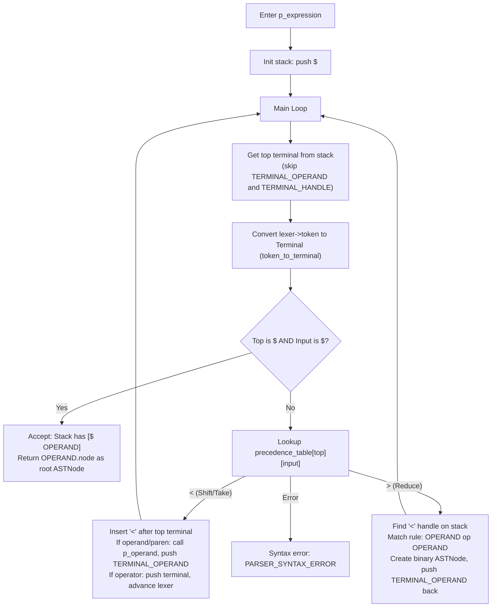

# Precedence Syntax Analysis (PSA) Specification & Implementation Plan

With [`p_operand`](file:///home/phuid/fit/ifj26-compiler/src/parser.c#L368) handling literals, variables, function calls, and **recursively handling parenthesized expressions `( expr )`**, this document specifies the complete architecture and implementation plan for the bottom-up precedence parser in [`psa.h`](file:///home/phuid/fit/ifj26-compiler/src/psa.h), [`psa.c`](file:///home/phuid/fit/ifj26-compiler/src/psa.c), and [`p_expression`](file:///home/phuid/fit/ifj26-compiler/src/parser.c#L486).

---

### High-Level Architecture Overview

Parentheses are factored out of the precedence table entirely:
* When an expression begins with `(`, it is dispatched to [`p_operand`](file:///home/phuid/fit/ifj26-compiler/src/parser.c#L368).
* [`p_operand`](file:///home/phuid/fit/ifj26-compiler/src/parser.c#L368) consumes `(`, recursively invokes [`p_expression`](file:///home/phuid/fit/ifj26-compiler/src/parser.c#L486), and consumes `)`.
* To the inner `p_expression`, `)` acts as [`TERMINAL_DOLLAR`](file:///home/phuid/fit/ifj26-compiler/src/psa.h#L21) (expression boundary).
* To the outer `p_expression`, the entire parenthesized expression `( ... )` enters as a single [`TERMINAL_OPERAND`](file:///home/phuid/fit/ifj26-compiler/src/psa.h#L20).



---

### 1. Stack Item Representation ([`psa.h`](file:///home/phuid/fit/ifj26-compiler/src/psa.h))

Because `(` and `)` are handled via `p_operand`, they **do not exist** in the precedence table or on the stack. The table needs only **8 terminals**:

```c
typedef enum {
  // Terminals participating in precedence table (indices 0 to 7)
  TERMINAL_PLUS,    // +
  TERMINAL_MINUS,   // -
  TERMINAL_MUL,     // *
  TERMINAL_DIV,     // /
  TERMINAL_CONCAT,  // ++
  TERMINAL_REL,     // <, <=, >, >=, ==, !=
  TERMINAL_OPERAND, // literals, variables, calls, parenthesized expressions ( expr )
  TERMINAL_DOLLAR,  // $ stack bottom / end of expression delimiter (\n, ;, ,, ), etc.)
  TERMINAL_COUNT,   // = 8 (dimension of precedence table)

  // Stack-only symbols (never looked up in table)
  TERMINAL_HANDLE,  // '<' reduction handle marker
  TERMINAL_INVALID  // sentinel for syntax errors
} TerminalType;

typedef struct {
  TerminalType type;
  ASTNode *node;    // Filled for TERMINAL_OPERAND, NULL for operators/delimiters
} Terminal;
```

---

### 2. Token Mapping in `token_to_terminal` ([`psa.c`](file:///home/phuid/fit/ifj26-compiler/src/psa.c))

Notice the role of `(` and `)`:
* `TOKEN_LEFT_PAREN` $\to$ **`TERMINAL_OPERAND`** (triggers shift $\to$ [`p_operand`](file:///home/phuid/fit/ifj26-compiler/src/parser.c#L368)).
* `TOKEN_RIGHT_PAREN` $\to$ **`TERMINAL_DOLLAR`** (signals to the inner [`p_expression`](file:///home/phuid/fit/ifj26-compiler/src/parser.c#L486) that the sub-expression is done).

```c
static TerminalType token_to_terminal(TokenType token) {
  switch (token) {
  case TOKEN_PLUS:
    return TERMINAL_PLUS;
  case TOKEN_MINUS:
    return TERMINAL_MINUS;
  case TOKEN_MULTIPLY:
    return TERMINAL_MUL;
  case TOKEN_DIVIDE:
    return TERMINAL_DIV;
  case TOKEN_LIST_CONCAT:
    return TERMINAL_CONCAT;

  // Relational operators
  case TOKEN_EQUAL:
  case TOKEN_NOT_EQUAL:
  case TOKEN_LESS:
  case TOKEN_GREATER:
  case TOKEN_LESS_EQUAL:
  case TOKEN_GREATER_EQUAL:
    return TERMINAL_REL;

  // Operands (including parenthesized sub-expressions)
  case TOKEN_INT:
  case TOKEN_DOUBLE:
  case TOKEN_STRING:
  case TOKEN_IDENTIFIER:
  case TOKEN_LEFT_PAREN:
    return TERMINAL_OPERAND;

  // Delimiters marking the end of an expression
  case TOKEN_EOF:
  case TOKEN_NEWLINE:
  case TOKEN_SEMICOLON:
  case TOKEN_COMMA:
  case TOKEN_COLON:
  case TOKEN_RIGHT_BRACKET:
  case TOKEN_RIGHT_PAREN:  // Ends inner parenthesized expression or call argument!
  case TOKEN_DEDENT:
  case TOKEN_KW_THEN:
  case TOKEN_KW_DO:
  case TOKEN_KW_ELSE:
    return TERMINAL_DOLLAR;

  default:
    return TERMINAL_INVALID;
  }
}
```

---

### 3. Parentheses in `p_operand` ([`parser.c`](file:///home/phuid/fit/ifj26-compiler/src/parser.c))

Add `case TOKEN_LEFT_PAREN:` to [`p_operand`](file:///home/phuid/fit/ifj26-compiler/src/parser.c#L368):

```c
case TOKEN_LEFT_PAREN: {
  // 1. Consume '('
  status = parser_expect_and_consume(lexer, TOKEN_LEFT_PAREN);
  if (status != PARSER_OK) {
    return status;
  }

  // 2. Recursively parse inner expression (newlines/indents allowed inside parens)
  ASTNode *inner_node = NULL;
  status = p_expression(lexer, program, function, scope, &inner_node, true, local_indent);
  if (status != PARSER_OK) {
    return status;
  }

  // Empty parentheses `()` are a syntax error
  if (inner_node == NULL) {
    return PARSER_SYNTAX_ERROR;
  }

  // 3. Consume matching ')'
  status = parser_expect_and_consume(lexer, TOKEN_RIGHT_PAREN);
  if (status != PARSER_OK) {
    ast_node_destroy(inner_node);
    return status;
  }

  *return_node = inner_node;
  return PARSER_OK;
}
```

---

### 4. Simplified Precedence Table ([`psa.c`](file:///home/phuid/fit/ifj26-compiler/src/psa.c))

With `(` and `)` factored out, the table shrinks to $8 \times 8$. **No `PREC_EQUAL` (`=`) is needed anywhere:**

```c
#define T PREC_TAKE    // '<' (shift)
#define R PREC_REDUCE  // '>' (reduce)
#define I PREC_INVALID // ' ' (syntax error / end)

static const PRECEDENCE precedence_table[TERMINAL_COUNT][TERMINAL_COUNT] = {
/* Stack \ Input:  +   -   *   /  ++  rel  i   $  */
/* +       */   {  R,  R,  T,  T,  R,  R,  T,  R  },
/* -       */   {  R,  R,  T,  T,  R,  R,  T,  R  },
/* *       */   {  R,  R,  R,  R,  R,  R,  T,  R  },
/* /       */   {  R,  R,  R,  R,  R,  R,  T,  R  },
/* ++      */   {  T,  T,  T,  T,  R,  R,  T,  R  },
/* rel     */   {  T,  T,  T,  T,  T,  I,  T,  R  },
/* i       */   {  R,  R,  R,  R,  R,  R,  I,  R  },
/* $       */   {  T,  T,  T,  T,  T,  T,  T,  I  },
};
#undef T
#undef R
#undef I
```

---

### 5. Streamlined Reduction Engine (`psa_reduce`)

`psa_reduce` only has to handle **one single pattern**: binary operators (`$ < OPERAND op OPERAND`):

```c
static ParserStatus psa_reduce(TerminalStack *stack) {
  // Handle must be exactly 3 items: OPERAND op OPERAND
  if (stack->size < 4U) { // '<' + 3 items
    return PARSER_SYNTAX_ERROR;
  }

  size_t top_idx = stack->size - 1U;
  Terminal right = stack->data[top_idx];
  Terminal op    = stack->data[top_idx - 1U];
  Terminal left  = stack->data[top_idx - 2U];
  Terminal handle = stack->data[top_idx - 3U];

  if (handle.type != TERMINAL_HANDLE ||
      left.type != TERMINAL_OPERAND ||
      right.type != TERMINAL_OPERAND) {
    return PARSER_SYNTAX_ERROR;
  }

  ASTNode *bin_node = create_binary_node(op.type, left.node, right.node);
  if (bin_node == NULL) {
    return PARSER_INTERNAL_ERROR;
  }

  // Pop '<', left, op, right (4 items)
  stack->size -= 4U;

  // Push resulting OPERAND
  Terminal result = { .type = TERMINAL_OPERAND, .node = bin_node };
  return terminal_stack_push(stack, result);
}
```

---

### 6. Acceptance & Termination

1. Delimiters like `\n`, `;`, `,`, `)`, `then`, `do`, `EOF` map to `TERMINAL_DOLLAR`.
2. PSA does not consume delimiter tokens.
3. PSA reduces remaining operators until the stack is `[TERMINAL_DOLLAR, TERMINAL_OPERAND]`.
4. When `top_terminal == TERMINAL_DOLLAR` and `input_terminal == TERMINAL_DOLLAR`:
   * **Accept**: set `*return_node = stack->data[1].node`.
   * Return `PARSER_OK`.
5. If outer, the caller proceeds. If inside a recursive `p_operand( ( expr ) )`, control returns to `p_operand` which consumes `)`!

---

### 7. Implementation Roadmap

| Phase | Description | Files |
| :--- | :--- | :--- |
| **Phase 1: `p_operand` Parentheses** | Add `case TOKEN_LEFT_PAREN:` to `p_operand` calling `p_expression` recursively | [`parser.c`](file:///home/phuid/fit/ifj26-compiler/src/parser.c) |
| **Phase 2: Streamlined 8x8 Table** | Update `TerminalType`, `token_to_terminal`, and `precedence_table` to 8 terminals | [`psa.h`](file:///home/phuid/fit/ifj26-compiler/src/psa.h), [`psa.c`](file:///home/phuid/fit/ifj26-compiler/src/psa.c) |
| **Phase 3: Stack Helpers & Reducer** | Implement `stack_get_top_terminal` (skipping `OPERAND` and `HANDLE`), `stack_insert_handle`, and binary-only `psa_reduce` | [`psa.c`](file:///home/phuid/fit/ifj26-compiler/src/psa.c) |
| **Phase 4: Main Loop in `p_expression`** | Connect `p_operand` shift, `psa_reduce`, and acceptance condition in `p_expression` | [`parser.c`](file:///home/phuid/fit/ifj26-compiler/src/parser.c) |
| **Phase 5: Tests** | Add unit tests for `1 + 2 * 3`, `(1 + 2) * 3`, nested `((1 + 2) * (3 + 4))`, and error cases | `tests/psa_test.cc` |
