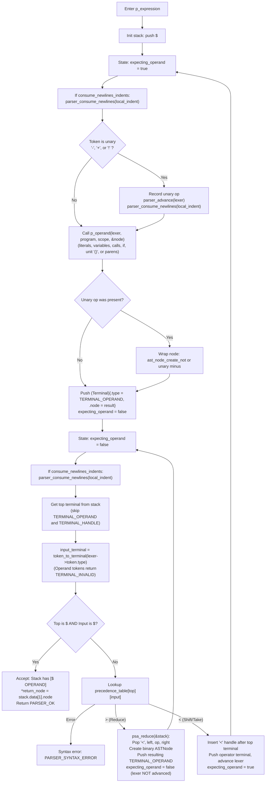

DISCLAIMER: This file was mostly generated by an LLM model: gemini 3.8 flash
It originated from basic functions and surrounding data structures (that is p_operand, TerminalStack, TerminalType, token_to_terminal) were basically copies of my hand-written code to this file. After that this file changed in about 10 conversations where I suggested a change and asked the model about potential downfalls of such approach. I thought about all of the models suggestions critically and i was the one editing the supporting data structures. From which changes to this file were deduced.

# Precedence Syntax Analysis (PSA) Specification & Implementation Plan

This document specifies the complete architecture and implementation plan for the bottom-up operator precedence parser across [psa.h](file:///home/edword/ifj26-compiler/src/psa.h), [psa.c](file:///home/edword/ifj26-compiler/src/psa.c), and [parser.c](file:///home/edword/ifj26-compiler/src/parser.c).

Under this design, **all subexpressions and primary operands are parsed by [`p_operand`](file:///home/edword/ifj26-compiler/src/parser.c#L519)**, which also handles parenthesized subexpressions `(expr)` and unit literals `()`. Unary prefix operators (`-`, `+`, `!`) are checked in [`p_expression`](file:///home/edword/ifj26-compiler/src/parser.c#L643) when expecting an operand, and are immediately followed by an operand intake via `p_operand`.

---

### High-Level Architecture Overview & Rationale

#### 1. Why Subexpressions and Unit Literals Belong in `p_operand`
* **Unified Operand Parsing**:
  `p_operand` is responsible for parsing any primary operand: literals (`Int`, `Double`, `String`, `Boolean`, and `Unit` `()`), variable references, function calls, `if` expressions, and parenthesized subexpressions `(expr)`.
* **Clean Handling of Unit Literal `()` vs `(expr)`**:
  The unit literal in IFJ26 is defined as `()`. When `p_operand` encounters `(`, it consumes `(` and inspects the immediate next token:
  - If it is `)`, it consumes `)` and returns a node created via `ast_node_create_unit(line, column)`.
  - If it is not `)`, it establishes a nested indentation scope and recursively calls `p_expression(..., true, &nested_indent)`.
* **Simplifying Unary Operators (`-`, `+`, `!`)**:
  By having `p_operand` handle both atomic operands and parenthesized subexpressions, unary prefix operators (`-`, `+`, `!`) can simply delegate to `p_operand` to parse their target (e.g. `-5` or `-(a + b)`), without needing duplicate subexpression dispatch logic.
* **Local Layout Handling in `p_operand`**:
  `p_operand` does not receive `consume_newlines_indents` or `local_indent`. Its caller, `p_expression`, handles any layout before the operand. When `p_operand` opens its own parenthesized subexpression, it creates a local `nested_indent`, consumes layout within those parentheses, and passes `true` and `&nested_indent` to the recursive `p_expression` call.

#### 2. The State Alternation Model (`expecting_operand`)
Expressions strictly alternate between operands and operators:
1. `expecting_operand == true`:
   - Consume leading newlines/indents if `consume_newlines_indents` is enabled.
   - Check for unary prefix operators (`-`, `+`, `!`): if present, consume the operator token and consume any following newlines. Right after, an operand must follow.
   - Call `p_operand(lexer, program, scope, &operand_node)`.
   - If a unary operator was present, wrap `operand_node` with the appropriate unary node (e.g. `ast_node_create_not` for `!`, or unary minus).
   - Push the resulting AST node onto the stack as `TERMINAL_OPERAND`, and transition to `expecting_operand = false`.
   - Any unexpected token (such as a bare binary operator or delimiter without an operand) produces an immediate syntax error.
2. `expecting_operand == false`:
   - The next token must be an operator or delimiter.
   - Incoming tokens are converted via `token_to_terminal(lexer->token.type)`. Tokens that start operands return `TERMINAL_INVALID`, immediately triggering a syntax error on consecutive operands (e.g. `1 2` or `x y`).
   - We inspect the top terminal on the stack (skipping `TERMINAL_OPERAND` and `TERMINAL_HANDLE` via `stack_get_top_terminal`) and compare it against the input terminal in the 10x10 precedence table:
     * **Accept**: Top is `$` and Input is `$`. The expression is complete.
     * **Shift (`<`)**: Insert `<` handle after the top terminal, push the operator terminal, advance the lexer, and transition back to `expecting_operand = true`.
     * **Reduce (`>`)**: Invoke `psa_reduce`, which pops `< left op right`, constructs a binary `ASTNode`, pushes the resulting `TERMINAL_OPERAND`, and stays in `expecting_operand = false` (lexer is not advanced).



---

### 1. Stack Item Representation ([`src/psa.h`](file:///home/edword/ifj26-compiler/src/psa.h))

Because `(` and `)` are factored out of the precedence table entirely, and because `TERMINAL_OPERAND` is never compared to any terminal (operands enter the stack evaluated and `stack_get_top_terminal` skips them), the precedence table requires only the 9 operator categories and delimiter `$` (**10 terminals**).

To keep the precedence table compact, operators with identical precedence and associativity are grouped under a shared `TerminalType` (e.g. relational operators `<`, `<=`, `>`, `>=` share `TERMINAL_REL`, and equality operators `==`, `!=` share `TERMINAL_EQUAL`). To preserve the exact operation and source coordinates for AST construction without enlarging the precedence table, `Terminal` stores the original `Token`:

```c
typedef enum {
  // Terminals that can be looked up in the precedence table
  TERMINAL_PLUS,   // +
  TERMINAL_MINUS,  // -
  TERMINAL_MUL,    // *
  TERMINAL_DIV,    // /
  TERMINAL_CONCAT, // ++
  TERMINAL_REL,    // <, <=, >, >=
  TERMINAL_EQUAL,  // ==, !=
  TERMINAL_AND,    // &&
  TERMINAL_OR,     // ||
  TERMINAL_DOLLAR, // $ stack bottom / end of expression delimiter
  TERMINAL_COUNT,  // = 10 (dimension of precedence table)

  // Stack-only symbols (never looked up in table)
  TERMINAL_OPERAND, // any subexpression (variable, literal, function call, AST node)
  TERMINAL_HANDLE,  // '<' reduction handle marker
  TERMINAL_INVALID  // sentinel for syntax errors
} TerminalType;

typedef struct {
  TerminalType type;
  Token token;      // Full original token for operators/delimiters; TOKEN_INVALID for TERMINAL_OPERAND
  ASTNode *node;    // Non-null for TERMINAL_OPERAND, NULL for operators/delimiters
} Terminal;

typedef struct {
  Terminal *data;
  size_t size;
  size_t capacity;
} TerminalStack;
```

---

### 2. Token Mapping in `token_to_terminal` ([`src/psa.c`](file:///home/edword/ifj26-compiler/src/psa.c))

When the parser is in `expecting_operand == false`, incoming tokens are mapped to their operator terminal or `TERMINAL_DOLLAR`. `token_to_terminal` is **only** called in this state.

Tokens with which operands start (`TOKEN_INT`, `TOKEN_DOUBLE`, `TOKEN_STRING`, `TOKEN_IDENTIFIER`, `TOKEN_KW_TRUE`, `TOKEN_KW_FALSE`, `TOKEN_LEFT_PAREN`, etc.) are omitted from the mapping and fall through to `default: return TERMINAL_INVALID;`. This guarantees that consecutive operands (e.g. `1 2`, `x y`, or `a ( b )`) immediately trigger a syntax error (`PARSER_SYNTAX_ERROR`).

```c
static TerminalType token_to_terminal(TokenType token) {
  switch (token) {
  case TOKEN_PLUS:
    return TERMINAL_PLUS;
  case TOKEN_MINUS:
    return TERMINAL_MINUS;
  case TOKEN_MULTIPLY:
    return TERMINAL_MUL;
  case TOKEN_DIVIDE:
    return TERMINAL_DIV;
  case TOKEN_LIST_CONCAT:
    return TERMINAL_CONCAT;

  // Relational operators (<, <=, >, >=)
  case TOKEN_LESS:
  case TOKEN_GREATER:
  case TOKEN_LESS_EQUAL:
  case TOKEN_GREATER_EQUAL:
    return TERMINAL_REL;

  // Equality operators (==, !=)
  case TOKEN_EQUAL:
  case TOKEN_NOT_EQUAL:
    return TERMINAL_EQUAL;

  // Logical operators
  case TOKEN_AND:
    return TERMINAL_AND;
  case TOKEN_OR:
    return TERMINAL_OR;

  // Delimiters marking the end of an expression -> act as '$'
  case TOKEN_EOF:
  case TOKEN_NEWLINE:
  case TOKEN_SEMICOLON:
  case TOKEN_COMMA:
  case TOKEN_COLON:
  case TOKEN_RIGHT_PAREN:  // Ends inner parenthesized expression or call argument!
  case TOKEN_DEDENT:
  case TOKEN_KW_THEN:
  case TOKEN_KW_DO:
  case TOKEN_KW_ELSE:
    return TERMINAL_DOLLAR;

  default:
    // This applies to tokens with which operands start (literals, identifiers,
    // left paren, keywords), since they are not operators and are invalid when
    // expecting an operator.
    return TERMINAL_INVALID;
  }
}
```

---

### 3. Unified Operand Parsing in `p_operand` ([`src/parser.c`](file:///home/edword/ifj26-compiler/src/parser.c#L519))

[`p_operand`](file:///home/edword/ifj26-compiler/src/parser.c#L519) parses all primary operands, including literals, variable references, function calls, `if`-expressions, the unit literal `()`, and parenthesized subexpressions `(expr)`. It receives no layout parameters; only its parenthesis branch creates and manages a nested indentation level:

```c
static ParserStatus p_operand(Lexer *lexer, Program *program,
                              SymbolTable *scope, ASTNode **return_node) {
  if (lexer == NULL || program == NULL || scope == NULL || return_node == NULL) {
    return PARSER_INVALID_ARGUMENT;
  }

  ParserStatus status;
  switch (lexer->token.type) {
  case TOKEN_INT:
    *return_node = ast_node_create_int(lexer->token.value.int_value,
                                       lexer->token.line, lexer->token.column);
    return (*return_node != NULL) ? parser_advance(lexer) : PARSER_INTERNAL_ERROR;

  case TOKEN_DOUBLE:
    *return_node = ast_node_create_real(lexer->token.value.double_value,
                                        lexer->token.line, lexer->token.column);
    return (*return_node != NULL) ? parser_advance(lexer) : PARSER_INTERNAL_ERROR;

  case TOKEN_STRING:
    *return_node = ast_node_create_string(lexer->token.value.string_value,
                                          lexer->token.line, lexer->token.column);
    return (*return_node != NULL) ? parser_advance(lexer) : PARSER_INTERNAL_ERROR;

  case TOKEN_KW_TRUE:
    *return_node = ast_node_create_bool(true, lexer->token.line, lexer->token.column);
    return (*return_node != NULL) ? parser_advance(lexer) : PARSER_INTERNAL_ERROR;

  case TOKEN_KW_FALSE:
    *return_node = ast_node_create_bool(false, lexer->token.line, lexer->token.column);
    return (*return_node != NULL) ? parser_advance(lexer) : PARSER_INTERNAL_ERROR;

  case TOKEN_LEFT_PAREN: {
    size_t paren_line = lexer->token.line;
    size_t paren_column = lexer->token.column;

    // 1. Consume '('
    status = parser_advance(lexer);
    if (status != PARSER_OK) {
      return status;
    }

    // 2. Check for unit literal: immediate ')' after '(' -> ()
    if (lexer->token.type == TOKEN_RIGHT_PAREN) {
      *return_node = ast_node_create_unit(paren_line, paren_column);
      if (*return_node == NULL) {
        return PARSER_INTERNAL_ERROR;
      }
      return parser_advance(lexer); // consume ')'
    }

    // 3. Otherwise, parse parenthesized subexpression with isolated indentation scope
    ptrdiff_t nested_indent = 0;
    status = parser_consume_newlines(lexer, false, true, &nested_indent);
    if (status != PARSER_OK) {
      return status;
    }

    status = p_expression(lexer, program, scope, return_node, true, &nested_indent);
    if (status != PARSER_OK) {
      return status;
    }
    if (*return_node == NULL) {
      return PARSER_SYNTAX_ERROR;
    }

    status = parser_consume_newlines(lexer, false, true, &nested_indent);
    if (status != PARSER_OK) {
      ast_node_destroy(*return_node);
      *return_node = NULL;
      return status;
    }

    status = parser_status_from_lexer(
        lexer_change_current_indent(lexer, (-1) * nested_indent));
    if (status != PARSER_OK) {
      ast_node_destroy(*return_node);
      *return_node = NULL;
      return status;
    }

    status = parser_expect_and_consume(lexer, TOKEN_RIGHT_PAREN);
    if (status != PARSER_OK) {
      ast_node_destroy(*return_node);
      *return_node = NULL;
      return status;
    }

    return PARSER_OK;
  }

  case TOKEN_IDENTIFIER: {
    char *name = lexer->token.value.string_value;
    size_t line = lexer->token.line;
    size_t column = lexer->token.column;

    status = parser_advance(lexer);
    if (status != PARSER_OK) {
      return status;
    }

    if (lexer->token.type == TOKEN_LEFT_PAREN) {
      // Function call (p_call_args internally manages its own argument parentheses)
      FunctionSymbol *function = NULL;
      if (function_table_get_or_create(&program->functions, name, &function) != FUNCTION_TABLE_OK) {
        return PARSER_INTERNAL_ERROR;
      }
      ASTNode *call_node = ast_node_create_function_call(function, line, column);
      if (call_node == NULL) {
        return PARSER_INTERNAL_ERROR;
      }
      status = p_call_args(lexer, program, function, scope, call_node);
      if (status != PARSER_OK) {
        ast_node_destroy(call_node);
        return status;
      }
      status = parser_status_from_type(type_entity_depend(&function->return_type, &call_node->inferred_type));
      if (status != PARSER_OK) {
        ast_node_destroy(call_node);
        return status;
      }
      *return_node = call_node;
      return PARSER_OK;
    } else {
      // Variable reference
      Symbol *symbol = symbol_table_resolve(scope, name);
      if (symbol == NULL) {
        return PARSER_SEMANTIC_ERROR;
      }
      ASTNode *var_node = ast_node_create_variable_ref(symbol, line, column);
      if (var_node == NULL) {
        return PARSER_INTERNAL_ERROR;
      }
      status = parser_status_from_type(type_entity_depend(&symbol->type, &var_node->inferred_type));
      if (status != PARSER_OK) {
        ast_node_destroy(var_node);
        return status;
      }
      *return_node = var_node;
      return PARSER_OK;
    }
  }

  case TOKEN_KW_IF:
    return p_if_expression(lexer, program, scope, return_node);

  default:
    return PARSER_SYNTAX_ERROR;
  }
}
```

---

### 4. Compact 10x10 Precedence Table ([`src/psa.c`](file:///home/edword/ifj26-compiler/src/psa.c))

Operator precedence hierarchy (from highest to lowest):
1. Multiplicative: `*`, `/` (Left-associative)
2. Additive: `+`, `-` (Left-associative)
3. Concatenation: `++` (Right-associative: `a ++ b ++ c` $\to$ `a ++ (b ++ c)`)
4. Relational: `<`, `<=`, `>`, `>=` (Non-associative: `a < b < c` is a syntax error)
5. Equality: `==`, `!=` (Non-associative: `a == b == c` is a syntax error)
6. Logical AND: `&&` (Left-associative)
7. Logical OR: `||` (Left-associative)
8. Delimiter: `$` (Stack bottom / end of expression)

> [!NOTE]
> `TERMINAL_OPERAND` was removed from the precedence table because operands are never looked up against any terminal:
> - `stack_get_top_terminal` explicitly walks past `TERMINAL_OPERAND` and `TERMINAL_HANDLE` to retrieve the topmost operator or `$`.
> - The input token in `expecting_operand == false` is converted via `token_to_terminal`, which only produces operator terminals or `$` (operands return `TERMINAL_INVALID`).
> Thus, removing `TERMINAL_OPERAND` eliminates an unused row and column, making the table strictly **10 $\times$ 10** (`TERMINAL_COUNT` $\times$ `TERMINAL_COUNT`).

```c
#define T PREC_TAKE    // '<' (shift operator)
#define R PREC_REDUCE  // '>' (reduce handle)
#define E PREC_EQUAL   // '=' (handle equivalence)
#define I PREC_INVALID // ' ' (syntax error / acceptance)

static const PRECEDENCE precedence_table[TERMINAL_COUNT][TERMINAL_COUNT] = {
    /* Stack \ Input: +  -  *  /  ++ <= == && || $  */
    /* +          */ {I, I, I, I, I, I, I, I, I, I},
    /* -          */ {I, I, I, I, I, I, I, I, I, I},
    /* *          */ {I, I, I, I, I, I, I, I, I, I},
    /* /          */ {I, I, I, I, I, I, I, I, I, I},
    /* ++         */ {I, I, I, I, I, I, I, I, I, I},
    /* <=         */ {I, I, I, I, I, I, I, I, I, I},
    /* ==         */ {I, I, I, I, I, I, I, I, I, I},
    /* &&         */ {I, I, I, I, I, I, I, I, I, I},
    /* ||         */ {I, I, I, I, I, I, I, I, I, I},
    /* $          */ {I, I, I, I, I, I, I, I, I, I},
};
#undef T
#undef R
#undef E
#undef I
```

---

### 5. Streamlined Reduction Engine (`psa_reduce`)

Because operands are directly pushed onto the stack as `TERMINAL_OPERAND` and `<` handles are only inserted when shifting operators, `psa_reduce` only ever needs to handle **one single reduction rule**: `< OPERAND op OPERAND`.

For cleaner error propagation, mapping the operator token to its AST kind is separated into `token_to_binary_op`:
- If `token_to_binary_op` encounters an unexpected token, it returns `PSA_INVALID_ARGUMENT`, allowing `psa_reduce` to produce `PSA_SYNTAX_ERROR` (or `PARSER_SYNTAX_ERROR`).
- If `ast_node_create_binary_op` fails (due to memory allocation failure), `psa_reduce` produces `PSA_INTERNAL_ERROR` (or `PARSER_INTERNAL_ERROR`).

> [!TIP]
> **Binary Op Guards in [`src/ast.c`](file:///home/edword/ifj26-compiler/src/ast.c#L318-L335)**:
> [`ast_node_create_binary_op`](file:///home/edword/ifj26-compiler/src/ast.c#L309) guards valid binary kinds via a `switch` that includes all arithmetic, relational, equality, concatenation, and logical operators (`AST_ADD` through `AST_OR`), fully matching all kinds produced by `token_to_binary_op`.

```c
PsaStatus token_to_binary_op(TokenType token_type, ASTNodeKind *return_kind) {
  switch (token_type) {
  case TOKEN_PLUS:          *return_kind = AST_ADD;           return PSA_OK;
  case TOKEN_MINUS:         *return_kind = AST_SUBTRACT;      return PSA_OK;
  case TOKEN_MULTIPLY:      *return_kind = AST_MULTIPLY;      return PSA_OK;
  case TOKEN_DIVIDE:        *return_kind = AST_DIVIDE;        return PSA_OK;
  case TOKEN_LIST_CONCAT:   *return_kind = AST_CONCAT;        return PSA_OK;
  case TOKEN_EQUAL:         *return_kind = AST_EQUAL;         return PSA_OK;
  case TOKEN_NOT_EQUAL:     *return_kind = AST_NOT_EQUAL;     return PSA_OK;
  case TOKEN_LESS:          *return_kind = AST_LESS;          return PSA_OK;
  case TOKEN_LESS_EQUAL:    *return_kind = AST_LESS_EQUAL;    return PSA_OK;
  case TOKEN_GREATER:       *return_kind = AST_GREATER;       return PSA_OK;
  case TOKEN_GREATER_EQUAL: *return_kind = AST_GREATER_EQUAL; return PSA_OK;
  case TOKEN_AND:           *return_kind = AST_AND;           return PSA_OK;
  case TOKEN_OR:            *return_kind = AST_OR;            return PSA_OK;
  default:
    return PSA_INVALID_ARGUMENT;
  }
}

static PsaStatus psa_reduce(TerminalStack *stack) {
  // Reduction pattern must be exactly 4 items: '<' OPERAND op OPERAND
  if (stack->size < 4U) {
    return PSA_SYNTAX_ERROR;
  }

  size_t top_idx = stack->size - 1U;
  Terminal right  = stack->data[top_idx];
  Terminal op     = stack->data[top_idx - 1U];
  Terminal left   = stack->data[top_idx - 2U];
  Terminal handle = stack->data[top_idx - 3U];

  if (handle.type != TERMINAL_HANDLE ||
      left.type != TERMINAL_OPERAND ||
      op.type == TERMINAL_OPERAND ||
      right.type != TERMINAL_OPERAND) {
    return PSA_SYNTAX_ERROR;
  }

  ASTNodeKind op_kind;
  if (token_to_binary_op(op.token.type, &op_kind) != PSA_OK) {
    return PSA_SYNTAX_ERROR;
  }

  ASTNode *bin_node = ast_node_create_binary_op(op_kind, left.node, right.node,
                                                op.token.line, op.token.column);
  if (bin_node == NULL) {
    return PSA_INTERNAL_ERROR;
  }

  // Pop '<', left, op, right (4 items)
  stack->size -= 4U;

  // Push resulting evaluated operand
  Terminal result = {
    .type = TERMINAL_OPERAND,
    .token = (Token){.type = TOKEN_INVALID, .line = op.token.line, .column = op.token.column},
    .node = bin_node
  };
  return terminal_stack_push(stack, result);
}
```

---

### 6. Acceptance & Termination

1. Expression delimiters (`\n`, `;`, `,`, `)`, `then`, `do`, `EOF`) map to `TERMINAL_DOLLAR`.
2. PSA does not consume delimiter tokens: they remain in `lexer->token` for the caller (or parent `p_expression`) to inspect or consume.
3. Operators on the stack continue reducing until the stack contains `[$ , OPERAND]`.
4. When `top_terminal == TERMINAL_DOLLAR` and `input_terminal == TERMINAL_DOLLAR`:
   * **Accept**: set `*return_node = stack->data[1].node`.
   * Free the stack structure and return `PARSER_OK`.
5. If outer, the statement parser proceeds. If inside a nested parenthesized expression, control returns to the outer `p_expression`, which consumes `)`.

---

### 7. Complete `p_expression` Main Loop Specification ([`src/parser.c`](file:///home/edword/ifj26-compiler/src/parser.c#L621))

Below is the complete implementation of [`p_expression`](file:///home/edword/ifj26-compiler/src/parser.c#L621):

> [!NOTE]
> **Unary Operators in AST**:
> - **Logical NOT (`!`)**: Constructed via [`ast_node_create_not`](file:///home/edword/ifj26-compiler/src/ast.h#L301) (`AST_NOT`), using `node->data.unary_op.operand`.
> - **Unary Minus (`-`)**: Desugared directly as binary subtraction: [`ast_node_create_binary_op`](file:///home/edword/ifj26-compiler/src/ast.h#L289)(`AST_SUBTRACT`, `left: ast_node_create_int(0)`, `right: operand`). This avoids adding a dedicated `AST_UNARY_MINUS` node kind and seamlessly reuses binary arithmetic evaluation.
> - **Unary Plus (`+`)**: Arithmetic identity ($+x = x$), returning `operand_node` directly without a wrapper.

```c
// Helper to safely clean up all AST nodes remaining on stack on syntax/internal errors
static void terminal_stack_cleanup_nodes(TerminalStack *stack) {
  if (stack == NULL || stack->data == NULL) return;
  for (size_t i = 0; i < stack->size; i++) {
    if (stack->data[i].type == TERMINAL_OPERAND && stack->data[i].node != NULL) {
      ast_node_destroy(stack->data[i].node);
      stack->data[i].node = NULL;
    }
  }
  terminal_stack_destroy(stack);
}

static ParserStatus p_expression(Lexer *lexer, Program *program,
                                 SymbolTable *scope, ASTNode **return_node,
                                 bool consume_newlines_indents,
                                 ptrdiff_t *local_indent) {
  if (lexer == NULL || program == NULL || scope == NULL || return_node == NULL) {
    return PARSER_INVALID_ARGUMENT;
  }
  if (consume_newlines_indents && local_indent == NULL) {
    return PARSER_INVALID_ARGUMENT;
  }

  TerminalStack stack;
  ParserStatus status = terminal_stack_init(&stack);
  if (status != PARSER_OK) {
    return status;
  }

  // Push '$' as stack bottom
  Terminal bottom = {.type = TERMINAL_DOLLAR, .token = (Token){.type = TOKEN_INVALID}, .node = NULL};
  status = terminal_stack_push(&stack, bottom);
  if (status != PARSER_OK) {
    terminal_stack_destroy(&stack);
    return status;
  }

  bool expecting_operand = true;

  while (true) {
    if (expecting_operand) {
      // 1. Consume any leading newlines/indents if multiline is permitted
      if (consume_newlines_indents) {
        status = parser_consume_newlines(lexer, false, true, local_indent);
        if (status != PARSER_OK) {
          terminal_stack_cleanup_nodes(&stack);
          return status;
        }
      }

      // 2. Check for unary prefix operators ('-', '+', '!')
      TokenType unary_op = TOKEN_INVALID;
      size_t unary_line = 0;
      size_t unary_column = 0;

      if (lexer->token.type == TOKEN_MINUS ||
          lexer->token.type == TOKEN_PLUS ||
          lexer->token.type == TOKEN_NOT) {
        unary_op = lexer->token.type;
        unary_line = lexer->token.line;
        unary_column = lexer->token.column;

        status = parser_advance(lexer);
        if (status != PARSER_OK) {
          terminal_stack_cleanup_nodes(&stack);
          return status;
        }

        if (consume_newlines_indents) {
          status = parser_consume_newlines(lexer, false, true, local_indent);
          if (status != PARSER_OK) {
            terminal_stack_cleanup_nodes(&stack);
            return status;
          }
        }
      }

      // 3. Right after, an operand MUST follow (parsed by p_operand)
      ASTNode *operand_node = NULL;
      status = p_operand(lexer, program, scope, &operand_node);
      if (status != PARSER_OK) {
        terminal_stack_cleanup_nodes(&stack);
        return status;
      }

      // 4. Wrap with unary AST node if a unary operator was present
      if (unary_op == TOKEN_NOT) {
        ASTNode *not_node = ast_node_create_not(operand_node, unary_line, unary_column);
        if (not_node == NULL) {
          ast_node_destroy(operand_node);
          terminal_stack_cleanup_nodes(&stack);
          return PARSER_INTERNAL_ERROR;
        }
        operand_node = not_node;
      } else if (unary_op == TOKEN_MINUS) {
        ASTNode *zero_node = ast_node_create_int(0, unary_line, unary_column);
        if (zero_node == NULL) {
          ast_node_destroy(operand_node);
          terminal_stack_cleanup_nodes(&stack);
          return PARSER_INTERNAL_ERROR;
        }
        ASTNode *neg_node = ast_node_create_binary_op(
            AST_SUBTRACT, zero_node, operand_node, unary_line, unary_column);
        if (neg_node == NULL) {
          ast_node_destroy(zero_node);
          ast_node_destroy(operand_node);
          terminal_stack_cleanup_nodes(&stack);
          return PARSER_INTERNAL_ERROR;
        }
        operand_node = neg_node;
      }
      // Note: TOKEN_PLUS is identity (+x == x), operand_node is passed unwrapped

      // 5. Push evaluated operand onto stack
      Terminal op_term = {
        .type = TERMINAL_OPERAND,
        .token = (Token){.type = TOKEN_INVALID},
        .node = operand_node
      };
      status = terminal_stack_push(&stack, op_term);
      if (status != PARSER_OK) {
        ast_node_destroy(operand_node);
        terminal_stack_cleanup_nodes(&stack);
        return status;
      }

      // Next token must be an operator or delimiter
      expecting_operand = false;

    } else {
      // --- Expecting Operator or End-of-Expression Delimiter ---
      if (consume_newlines_indents) {
        status = parser_consume_newlines(lexer, false, true, local_indent);
        if (status != PARSER_OK) {
          terminal_stack_cleanup_nodes(&stack);
          return status;
        }
      }

      Terminal top_terminal;
      status = stack_get_top_terminal(&stack, &top_terminal);
      if (status != PARSER_OK) {
        terminal_stack_cleanup_nodes(&stack);
        return status;
      }

      TerminalType input_terminal = token_to_terminal(lexer->token.type);

      // Check Acceptance Condition: top of stack is '$' AND input is '$'
      if (top_terminal.type == TERMINAL_DOLLAR && input_terminal == TERMINAL_DOLLAR) {
        if (stack.size == 2U && stack.data[1].type == TERMINAL_OPERAND) {
          *return_node = stack.data[1].node;
          terminal_stack_destroy(&stack);
          return PARSER_OK;
        }
        terminal_stack_cleanup_nodes(&stack);
        return PARSER_SYNTAX_ERROR;
      }

      if (input_terminal == TERMINAL_INVALID) {
        terminal_stack_cleanup_nodes(&stack);
        return PARSER_SYNTAX_ERROR;
      }

      PRECEDENCE prec = precedence_table[top_terminal.type][input_terminal];

      switch (prec) {
      case PREC_TAKE: {
        // Insert '<' handle after top terminal (before left operand of this operator)
        status = stack_insert_handle_after_top_terminal(&stack);
        if (status != PARSER_OK) {
          terminal_stack_cleanup_nodes(&stack);
          return status;
        }

        Terminal op_term = {
          .type = input_terminal,
          .token = lexer->token,
          .node = NULL
        };
        status = terminal_stack_push(&stack, op_term);
        if (status != PARSER_OK) {
          terminal_stack_cleanup_nodes(&stack);
          return status;
        }

        status = parser_advance(lexer);
        if (status != PARSER_OK) {
          terminal_stack_cleanup_nodes(&stack);
          return status;
        }

        expecting_operand = true;
        break;
      }

      case PREC_REDUCE: {
        status = psa_reduce(&stack);
        if (status != PARSER_OK) {
          terminal_stack_cleanup_nodes(&stack);
          return status;
        }
        // Do NOT advance lexer; re-evaluate input against the new top terminal
        expecting_operand = false;
        break;
      }

      case PREC_INVALID:
      default:
        terminal_stack_cleanup_nodes(&stack);
        return PARSER_SYNTAX_ERROR;
      }
    }
  }
}
```

---

### 8. Implementation Roadmap

| Phase | Description | Files |
| :--- | :--- | :--- |
| **Phase 1: Subexpression & Unit Parsing in `p_operand`** | Parse literals, variables, calls, if-exprs, unit `()` and parenthesized `(expr)`; manage layout locally with `nested_indent` only in the parenthesis branch | [`src/parser.c`](file:///home/edword/ifj26-compiler/src/parser.c) |
| **Phase 2: Precedence Table & Terminals** | Define 10 table terminals + stack symbols in `psa.h`; update `token_to_terminal` (operand tokens return `TERMINAL_INVALID`) and 10x10 `precedence_table` | [`src/psa.h`](file:///home/edword/ifj26-compiler/src/psa.h), [`src/psa.c`](file:///home/edword/ifj26-compiler/src/psa.c) |
| **Phase 3: Stack Helpers & Reducer** | Implement `stack_get_top_terminal`, `stack_insert_handle_after_top_terminal`, `token_to_binary_op`, and `psa_reduce`; extend `ast_node_create_binary_op` for all binary operators | [`src/psa.c`](file:///home/edword/ifj26-compiler/src/psa.c), [`src/ast.c`](file:///home/edword/ifj26-compiler/src/ast.c) |
| **Phase 4: Main Loop in `p_expression`** | Implement `p_expression` main loop with unary prefix handling (`-`, `+`, `!`), `p_operand` delegation, and shift/reduce/acceptance | [`src/parser.c`](file:///home/edword/ifj26-compiler/src/parser.c) |
| **Phase 5: Tests** | Add unit tests for `1 + 2 * 3`, `(1 + 2) * 3`, unit literal `()`, unary expressions `-x`, `!y`, multiline indentation within parens, and syntax errors | `tests/psa_test.cc` |
